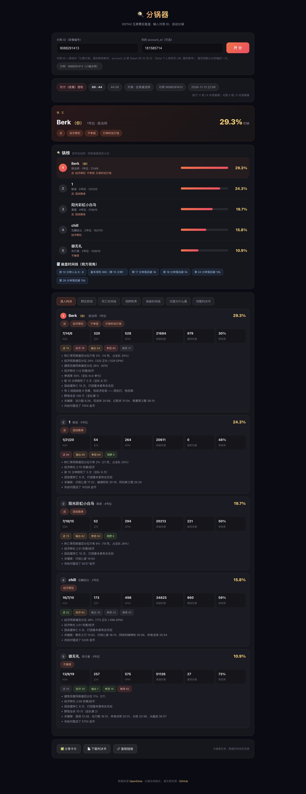
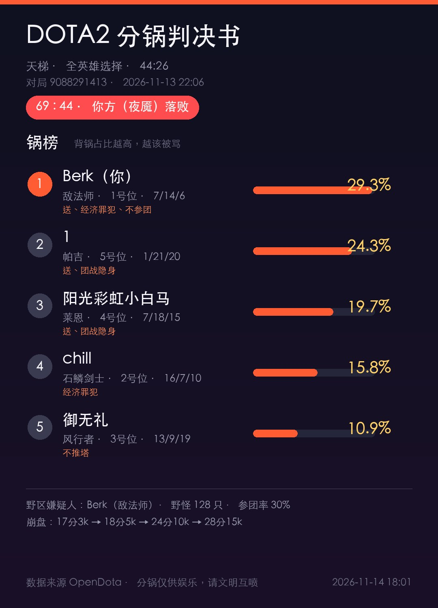

# 🍳 Dota 2 分锅器

> 仓库：<https://github.com/BerkMOON/dota-blame>

DOTA2 五黑赛后复盘工具。丢一个对局 ID 进去，自动从 OpenDota 拉数据、按号位加权算锅，
输出一份「分锅判决书」：谁在犯罪、谁在野区把线对、谁在送、谁在躺。

支持 **网页版 + CLI**，带分享卡片图，适合发群里友好互喷。





## 功能

- **锅榜**：5 人背锅占比 + 罪名（按 1~5 号位加权，不是简单比 KDA）
- **逐人判决**：KDA / 经济 / 输出 / 参团 / 推塔 / 视野 六维背锅分 + 判词
- **崩盘时间线**：前 10 分钟人头、经济差从 3k→5k→10k→15k 的崩盘节点
- **野区把线指数**：野怪击杀、团战伤害占比、「有效 0 伤团」（团在打他却 0 伤害还在涨钱）
- **死亡时间线**：前期/中期/后期死亡分布、送金总额、团战阵亡次数
- **视野与辅助职责**：真假眼数量、买活、堆野
- **装备时间线**：跳刀 / BKB / 狂战 / 神杖等关键装时间
- **对面为什么赢**：数据最好的 3 个对手
- **分享卡片**：一键生成 1080×1500 PNG
- 未解析对局自动降级为聚合数据版，并自动向 OpenDota 提交解析请求
- **解析完成自动提示**：未解析时每 15 秒轮询一次，解析好了自动弹提示并升级为精确版

## 快速开始

```bash
# 只依赖 Pillow（用于分享卡片）
pip3 install -r requirements.txt

# 启动网页版
python3 server/app.py
# 打开 http://127.0.0.1:8000
```

CLI / 直接出文件版：

```bash
python3 dota_blame.py 9088291413 --user 181585714            # 输出 report_9088291413.md
python3 dota_blame.py 9088291413 --user 181585714 --refresh  # 解析完成后强制重拉
```

> `--user` 是你的 account_id（Steam 32 位 ID），留空则默认分析输的一方。

## 接口

| 方法 | 路径 | 说明 |
|---|---|---|
| GET | `/api/health` | 健康检查 |
| GET | `/api/status?match_id=...` | 轻量查询是否已被 OpenDota 解析（前端轮询用） |
| GET | `/api/analyze?match_id=...&user_id=...` | 返回完整 JSON |
| GET | `/api/card?match_id=...&user_id=...` | 返回 PNG 分享卡片 |
| GET | `/api/report?match_id=...&user_id=...` | 返回 Markdown 判决书 |
| GET | `/` | 前端页面 |

环境变量：`PORT`（默认 8000）、`HOST`（默认 0.0.0.0）、`CACHE_TTL`（默认 300 秒）、`DOTA_BLAME_FONT`（自定义中文字体路径）。

## 测试

```bash
python3 -m unittest discover -s tests -v
```

包含未解析对局（`extra=None`）的回归测试。

## 部署

后端需要访问 OpenDota，**国内直连 opendota 时好时坏**，所以部署位置比部署方式更重要：

### 方案 A：香港 / 新加坡 VPS + Docker（推荐）

阿里云轻量（香港/新加坡）、腾讯云轻量、搬瓦工都行，2C2G 足够。

```bash
# 服务器上
git clone <仓库地址> && cd dota-blame
docker compose up -d --build
# 访问 http://服务器IP:8000
```

配 Nginx 反代 + HTTPS：

```nginx
server {
    listen 80;
    server_name blame.example.com;
    location / {
        proxy_pass http://127.0.0.1:8000;
        proxy_set_header Host $host;
        proxy_set_header X-Real-IP $remote_addr;
    }
}
```

### 方案 B：Render（免费，海外）

仓库推上去后在 Render 新建 Blueprint，会自动读取 `render.yaml`（Docker 部署，免费档会休眠）。
页面从国内访问可能偏慢，但后端访问 OpenDota 很稳。

### 方案 C：Fly.io

```bash
fly launch --copy-config --name dota-blame --region hkg
fly deploy
```

### 方案 D：直接跑在任意 Linux + systemd

```bash
pip3 install pillow
PORT=8000 python3 server/app.py
```

> 不建议直接放 Vercel/Netlify：后端是 Python 常驻服务（还有 Pillow 出图），放到 serverless 要重写。

## 架构

```
web/                 前端（原生 HTML/CSS/JS，无构建）
  index.html
  style.css
  app.js
server/
  app.py             HTTP 服务（Python 标准库，零 Web 框架依赖）
  card.py            Pillow 分享卡片
  __init__.py
dota_blame.py        分锅引擎（数据拉取 / 角色识别 / 五维评分 / Markdown 渲染 / JSON payload）
cache/               OpenDota 缓存与英雄名缓存（gitignored）
```

```
浏览器 → server/app.py → dota_blame.py → OpenDota API
                     ↘ card.py (Pillow) → PNG
```

## 分锅算法

五维背锅分（0-100，越高越背锅），每维 = 同英雄基准百分位取反 50% + 队内相对倒数 50%：

| 维度 | 计算 | 适用号位 |
|---|---|---|
| 送 | 阵亡率百分位 + 队内死亡 + 20% 前期死亡 | 全部 |
| 经济 | GPM 百分位取反 | 1/2/3 |
| 输出 | 英雄伤害/min 百分位 + 队内相对 | 全部 |
| 参团 | 团战参与率（K+A/团队击杀） | 全部 |
| 推塔 | 建筑伤害 | 1/2/3 |
| 视野 | 真假眼数量 | 4/5 |

再按号位加权、归一化成 5 人锅占比。权重在 `dota_blame.py` 的 `WEIGHTS` 里，想偏袒谁自己改。

## 已知局限

- 「野区」用野怪击杀 + 团战缺席 + 有效 0 伤团近似，还没接 `lane_pos` 位置热区；
- OpenDota 解析依赖社区解析池，刚打完的对局可能要等几分钟；
- 分锅是玄学：数据抓不到拉野、卡线、指挥、让刀等隐性贡献。

## 示例

- [完整判决书示例](examples/report_9088291413.md)
- 对局来自公开数据，`python3 dota_blame.py 9088291413 --user 181585714` 可复现

## License

MIT
